# DroneLink User Manual

Version 1.0 · October 2026

## 1. What DroneLink does

DroneLink puts a DJI drone's live camera view on a Windows or Mac computer. From there it hands the picture to OBS, to phones and laptops on the same Wi-Fi, to an MP4 recording, or straight to YouTube or Facebook. There is nothing to configure: open the app, copy one address into the drone app, and the picture appears.

It also includes a **test drone** that streams a simulated flight, so you can rehearse the whole setup without flying.

**What you need**

- A Windows 10/11 or macOS computer with DroneLink installed
- A DJI drone and the phone or screen controller you fly it with (DJI Fly, DJI GO 4 or DJI Pilot 2)
- One Wi-Fi network that both the computer and the phone or controller are joined to. A phone hotspot works.
- Internet only if you use **Go live**
- OBS Studio (free) only if you want to mix the drone into a broadcast

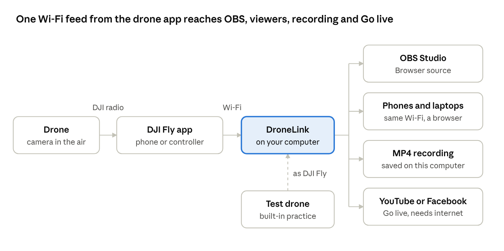

The drone's radio sets how far you can fly. DroneLink only needs the phone and the computer on the same Wi-Fi.

## 2. Install

**Windows**

1. Double-click `DroneLink-Setup-1.0.0.exe`.
2. If Windows shows "Windows protected your PC", click **More info**, then **Run anyway**. This appears because the app is not yet code-signed.
3. Click **Install**. The installer adds a Windows Firewall rule so drones can connect without a prompt.
4. Leave **Run DroneLink** ticked and click **Finish**. A desktop shortcut is created.

**Mac**

1. Open the DMG and drag **DroneLink** into **Applications**.
2. The first time only: in Applications, right-click DroneLink, choose **Open**, then **Open** again.
3. When macOS asks to allow incoming network connections, or to find devices on your local network, click **Allow**.

**If you missed a prompt**

- Windows: Start → "Allow an app through Windows Firewall" → tick **DroneLink** for both **Private** and **Public**.
- Mac: System Settings → Privacy & Security → **Local Network** → turn on DroneLink. Then System Settings → Network → Firewall → Options → set DroneLink to **Allow incoming connections**.

To uninstall, use Settings → Apps on Windows (this also removes the firewall rule), or drag DroneLink to the Bin on Mac.

**Why it says "unsafe" or "unidentified developer"**

The current test build is not code-signed yet, so Windows and macOS cannot show who published it. The app is the same either way. Signed releases install with no warning:

| Platform | How it will be signed | Cost |
| --- | --- | --- |
| Windows | Published through the Microsoft Store, which signs the app | Free for individual developers |
| Windows, direct download | OV code-signing certificate | About US$150–300 a year |
| Mac | Apple Developer Program, Developer ID and notarization | A$149 a year |

## 3. The main screen

Everything is on one screen. The orange **drone address** on the right is the only thing a pilot needs.

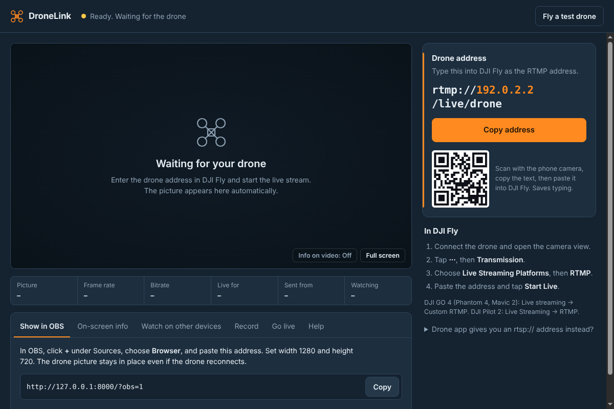

When a drone is live, the picture fills the preview and the stats bar fills in:

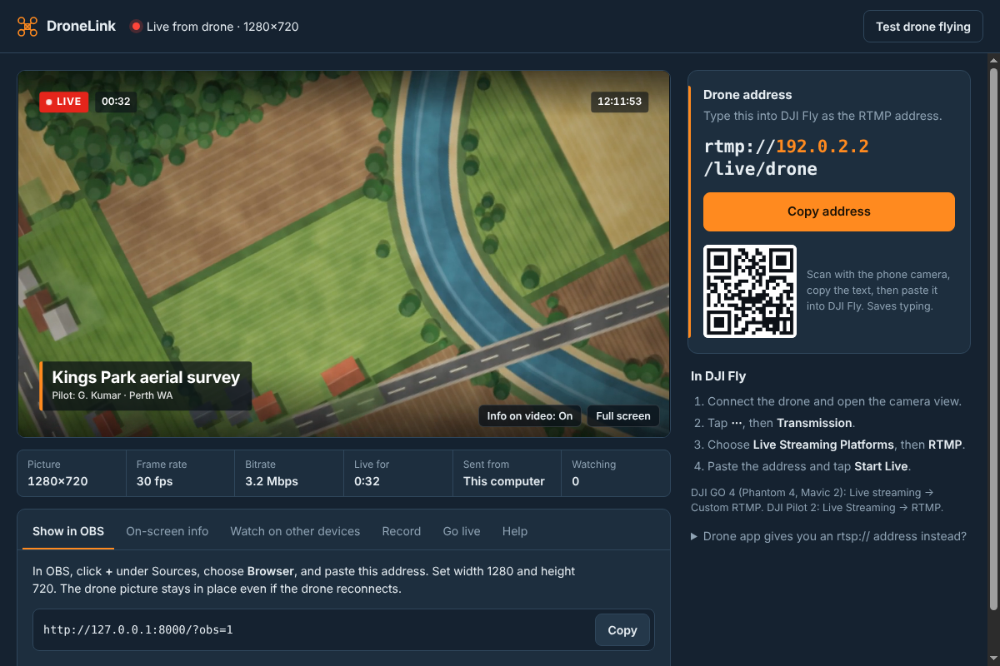

| Area | What it shows or does |
| --- | --- |
| Status (top left) | Yellow dot: ready and waiting. Red dot: live. Blinking yellow: drone feed paused, waiting to reconnect. Red text: a problem, with the reason. |
| Fly a test drone (top right) | Opens the test drone panel (section 5). |
| Preview | The live picture, about 1 second behind the controller. Hover over it for **Info on video** and **Full screen**. |
| Stats bar | Picture size, frame rate, bitrate, time live, which device is sending ("This computer" or the phone's IP), and how many viewers are watching. |
| Tabs | Show in OBS, On-screen info, Watch on other devices, Record, Go live, Help. |
| Drone address | The address to type into the drone app, with a Copy button and a QR code. |
| Network | Appears only when the computer is on more than one network. Pick the Wi-Fi the phone is on. |
| In DJI Fly | A reminder of where the setting lives in the drone app. |

The address updates by itself if you change Wi-Fi or turn a hotspot on or off. If another program already uses the usual port, DroneLink picks the next free one and adds it to the address, for example `rtmp://192.168.1.20:1936/live/drone`. Always copy the address exactly as shown.

## 4. Connect a real drone

The drone app sends the video to the computer over Wi-Fi. First join the phone (or a screen controller such as DJI RC Pro) and the computer to the **same Wi-Fi**. Then open DroneLink and click **Copy address**.

**Getting the address onto the phone**

- Scan the QR code with the phone camera, tap the text that appears, and copy it, or
- Type it in by hand. It is short: `rtmp://` + the orange numbers + `/live/drone`.

**DJI Fly** (Mini 2, 3, 4, 5 series, Air 2S, Air 3, Air 3S, Mavic 3 series, Avata, FPV, Neo, Flip)

1. Power on the drone and controller, open DJI Fly, and go to the camera view.
2. Tap **···** (top right), then the **Transmission** tab.
3. Tap **Live Streaming Platforms**, then **RTMP**.
4. Paste the DroneLink address and tap **Start Live**.
5. Within a few seconds DroneLink shows "Drone connected from 192.168.x.x" and the picture appears.
6. Keep DJI Fly open on screen while streaming. If you switch apps or lock the phone, the stream stops.

**DJI GO 4** (Phantom 4, Mavic 2, Mavic Air, Spark)

1. In the camera view, tap **···** → **General settings** → **Live streaming platforms**.
2. Choose **Custom RTMP**, paste the address, and tap **Start**.

**DJI Pilot 2** (Matrice series, Mavic 3 Enterprise)

- RTMP: open **Live Streaming** → **RTMP**, paste the address and start, the same as DJI Fly.
- RTSP: if Pilot 2 shows you an `rtsp://` address instead, open **Drone app gives you an rtsp:// address instead?** in DroneLink, paste it, and click **Connect**. DroneLink fetches the feed from the controller.

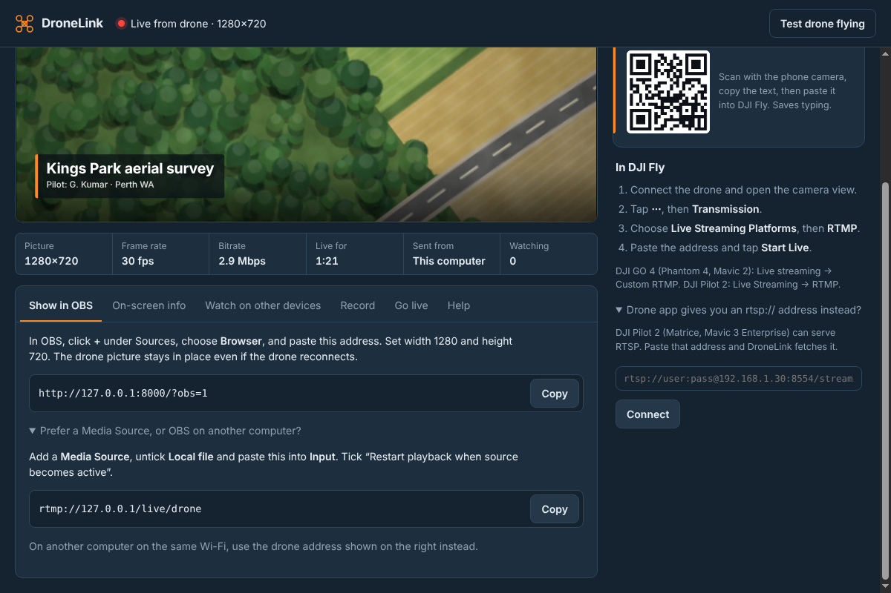

**Stopping:** tap **Stop Live** in the drone app. DroneLink waits 30 seconds in case it was a dropout, then goes back to "Waiting for the drone".

**Goggles-only flights** (Avata or FPV without a phone) have no app to stream from. Use a controller with HDMI out and a USB capture card into OBS instead.

**Can I split the controller's USB cable to the phone and the computer?**

No. The USB link between the controller (RC-N1, RC-N2, RC-N3) and the phone works with one device only, and the video on it is DJI's own format that only DJI Fly can read. A USB-C splitter leaves the computer with no picture. These options all let the pilot keep flying:

| Option | Setup | Notes |
| --- | --- | --- |
| Wi-Fi from DJI Fly (standard) | Phone stays on the controller and DJI Fly streams to DroneLink, as in this section | Works with every phone-based DJI drone. About 1 to 3 seconds delay. Clean picture. |
| Controller with HDMI out | DJI RC Pro or Smart Controller: HDMI into a USB capture card, then OBS **Video Capture Device** | Near-zero delay, no Wi-Fi needed. Mirrors the pilot's screen, flight display included. DroneLink not needed. |
| Powered USB-C hub with HDMI on the phone | Phone into the hub, controller into the hub's USB port, HDMI to a capture card | Only phones with USB-C video out (many Samsung phones, iPhone 15 and later). Not confirmed by DJI, so test on the ground first. |

The DJI RC, RC 2 and RC-N series controllers have no HDMI port.

## 5. Fly the test drone

The test drone is a pretend drone inside DroneLink. It flies a figure-eight over a generated landscape and streams it exactly the way DJI Fly does: 720p or 1080p H.264 video at 30 fps, with silent audio. Everything that works with the test drone works with a real one.

**Take off**

1. Click **Fly a test drone** (top right).
2. Leave **This computer** selected.
3. Choose **720p** (like DJI Fly) or **1080p**.
4. Click **Take off**. After 2 to 3 seconds the status turns green ("Streaming to…") and altitude, speed, distance and battery start counting.
5. Close the panel with **✕**. The test drone keeps flying, and the top button reads **Test drone flying**.

**Show flight display (HUD) in the test picture** is **off by default**, so the test picture is clean video, exactly like a real DJI live stream. Tick it to draw a DJI-style display (altitude, speed, compass, battery) into the video. You can switch it while flying.

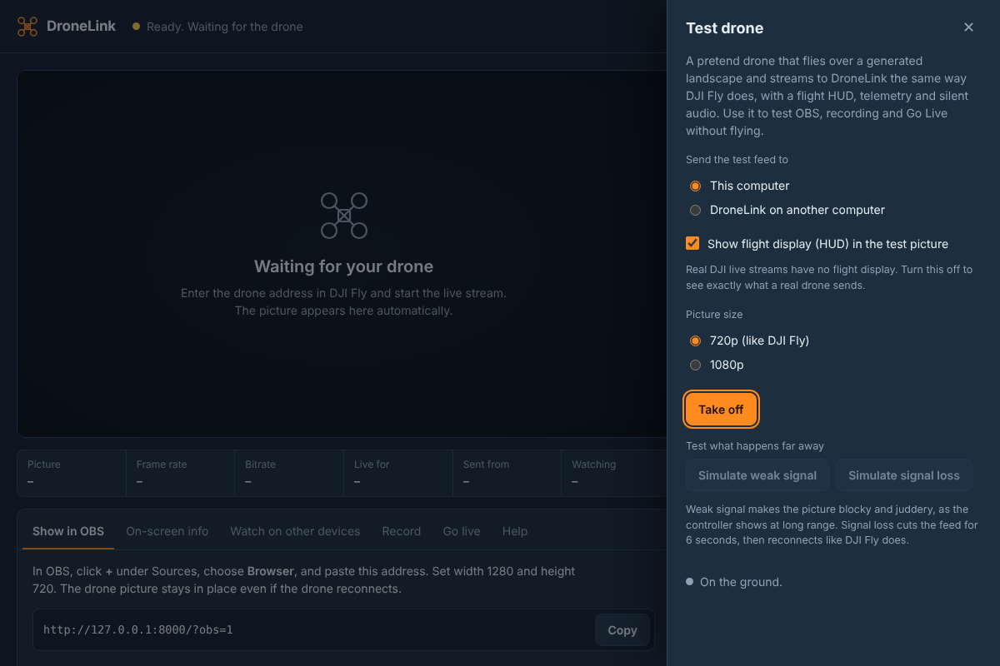

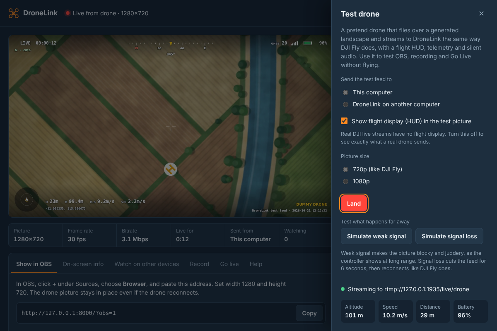

**Test what happens far away**

| Button | What happens | Use it to check |
| --- | --- | --- |
| Simulate weak signal | Picture turns blocky and juddery with short freezes, signal bars go red, and "Weak signal" appears, as on a controller at long range. Click again (**Restore strong signal**) to stop. | How your OBS scene and viewers look on a poor link |
| Simulate signal loss | Feed cuts for 6 seconds, then reconnects by itself, like DJI Fly does. | That OBS, viewers, recording and Go live all pick up again without anyone touching them |

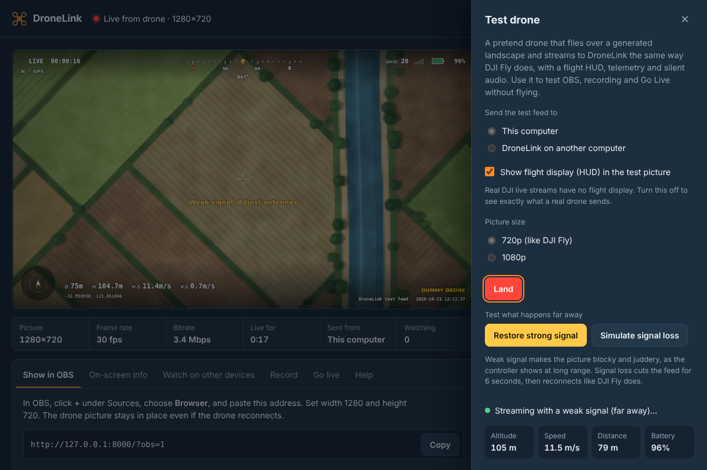

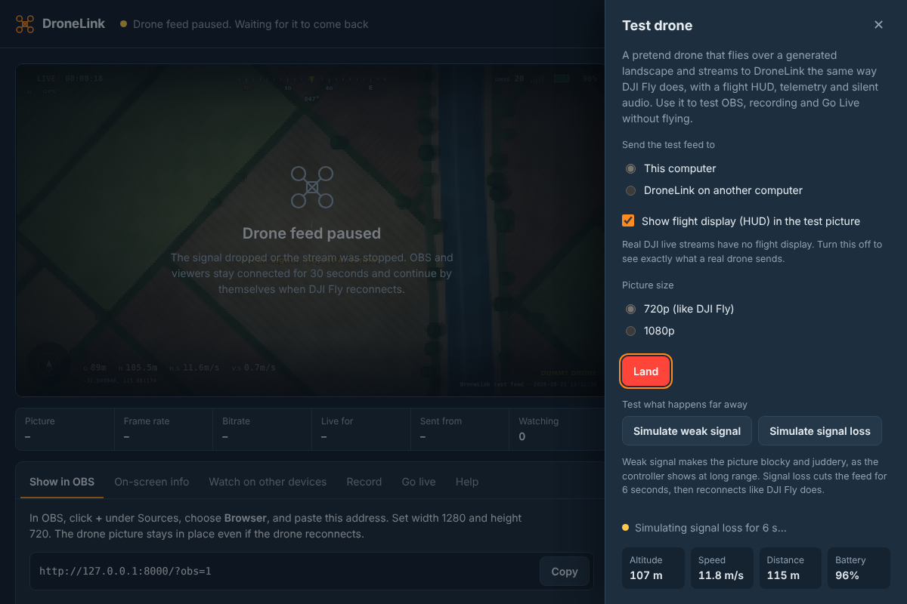

**Stream to DroneLink on another computer**

Use this to test across the network without a drone, for example from a laptop to the OBS machine.

1. On the receiving computer, open DroneLink and note the orange numbers in its drone address, for example `192.168.1.20`.
2. On the sending computer, open **Fly a test drone** and choose **DroneLink on another computer**.
3. Type those numbers and click **Take off**.
4. The receiving computer shows the picture, and **Sent from** shows the sender's IP.

**Land:** click **Land**. Closing DroneLink also lands it.

## 6. Show the drone in OBS

The **Browser source** is the recommended way. It stays in place when the drone drops out and reconnects, so you set it up once.

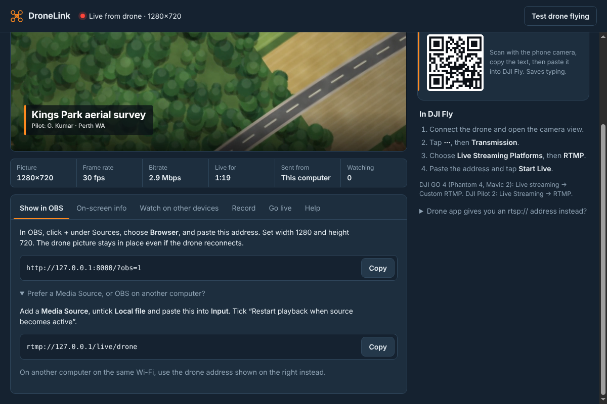

**Browser source (OBS on the same computer)**

1. In DroneLink, open the **Show in OBS** tab and click **Copy** next to `http://127.0.0.1:8000/?obs=1`.
2. In OBS, under **Sources**, click **+** and choose **Browser**. Name it "Drone" and click **OK**.
3. Paste the address into **URL**.
4. Set **Width** 1280 and **Height** 720 (1920 × 1080 if the drone sends 1080p).
5. Click **OK**. The drone picture appears in the scene. The background is transparent until the drone is live.

The Browser source has no sound. DJI's live stream carries no real audio, so add your microphone or commentary as a separate OBS audio source.

**Media Source (alternative)**

1. Open **Prefer a Media Source, or OBS on another computer?** in the Show in OBS tab and copy `rtmp://127.0.0.1/live/drone`.
2. In OBS add a **Media Source**, untick **Local file**, and paste the address into **Input**.
3. Tick **Restart playback when source becomes active** and click **OK**.

**OBS on a different computer**

Use the same Media Source steps, but paste the **drone address** from the right-hand side of DroneLink (with the orange numbers) instead of the 127.0.0.1 address. Both computers must be on the same Wi-Fi or wired network.

## 7. On-screen info: LIVE badge, clock and title

DroneLink can lay a broadcast-style info layer over the drone picture, and you can hide it with one click for a clean picture. The same look appears in the app preview, the OBS Browser source and viewers' screens.

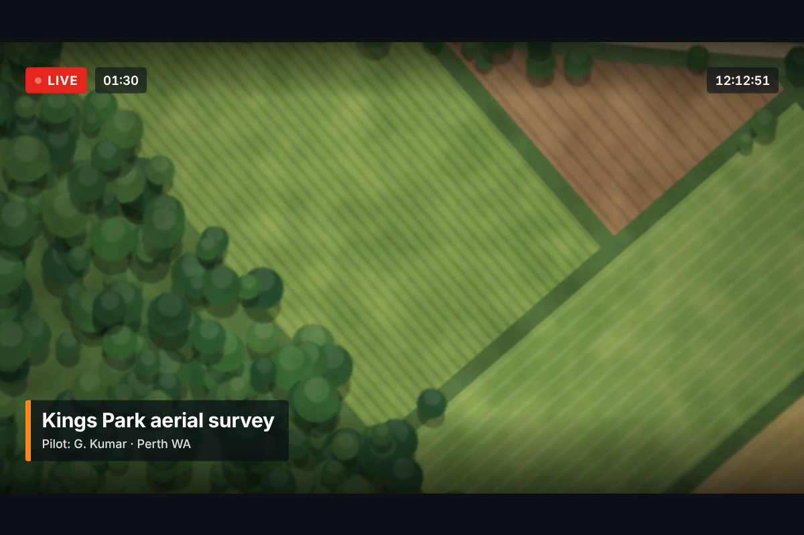

**Turn it on or off**

The info is **off by default** (from version 1.0.2), so viewers see only the video.

- Hover over the preview and click **Info on video: On / Off**, or press **I**.
- **Full screen** (or press **F**) fills the monitor with the preview. Press **Esc** to leave.

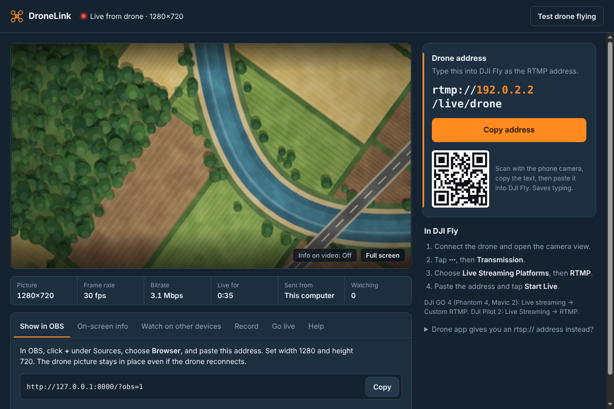

**Choose what shows** (On-screen info tab)

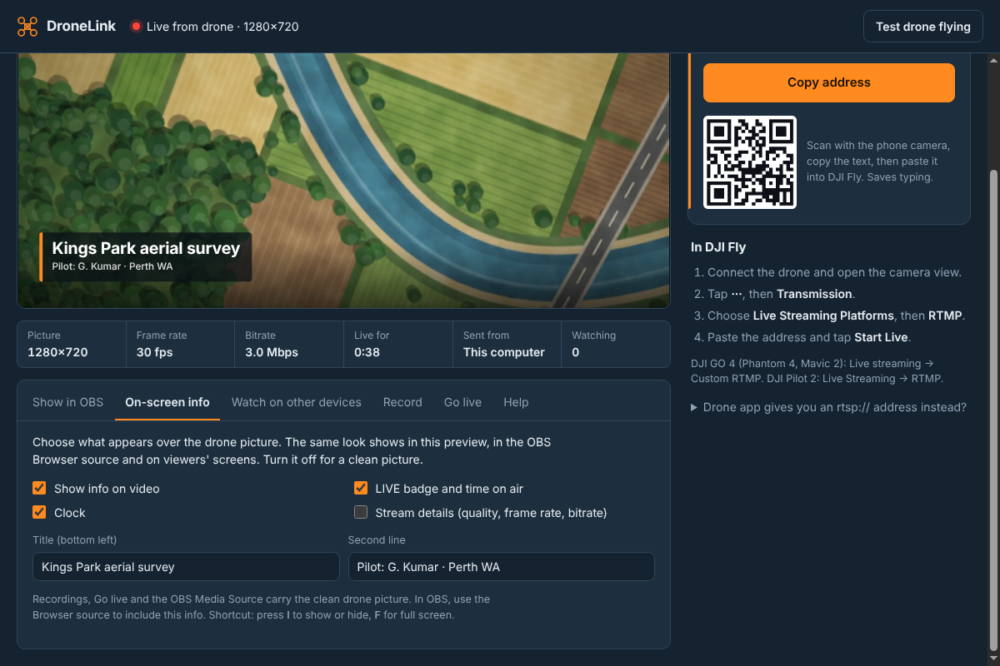

| Item | Where it appears |
| --- | --- |
| LIVE badge and time on air | Top left |
| Clock (computer's local time) | Top right |
| Title and second line, for example the location and pilot | Bottom left, as a lower third |
| Stream details: quality, frame rate, bitrate | Bottom right, off by default |

The info appears only while the drone is live. Changes show on OBS and viewers' screens within about a second, and DroneLink remembers your choices.

**Where it does not appear:** recordings, Go live and the OBS **Media Source** always carry the clean drone picture. To broadcast with the info, use the OBS **Browser source** and stream from OBS. For a clean Browser source while the preview keeps its info, add `&clean=1` to the end of its address: `http://127.0.0.1:8000/?obs=1&clean=1`.

## 8. Watch on phones, tablets and laptops

Anyone on the same Wi-Fi can watch the drone live in a web browser, with nothing to install.

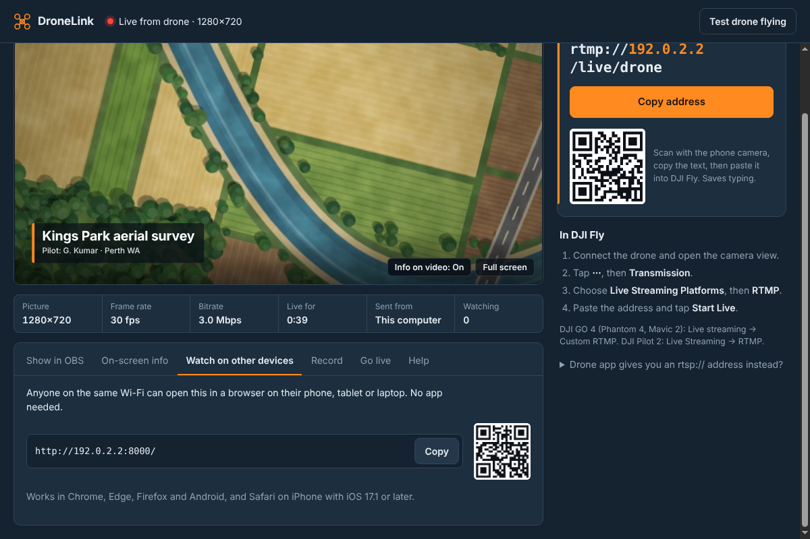

1. Open the **Watch on other devices** tab.
2. Let people scan the QR code, or send them the link, for example `http://192.168.1.20:8000/`.
3. The page shows "Waiting for the drone" until the pilot goes live, then plays full screen. It restarts by itself after a dropout.
4. **Watching** in the stats bar shows how many devices are viewing.

It works in Chrome, Edge and Firefox on any computer, on Android, and in Safari on iPhone or iPad with iOS 17.1 or later. Each viewer uses about 3 Mbps of the Wi-Fi (the drone's bitrate), so this suits a room of people. For larger audiences, use **Go live** to a platform instead.

The link only works inside your network, and there is no password, so use it on Wi-Fi you trust.

## 9. Record to MP4

DroneLink saves the live feed exactly as received, with no quality loss and almost no CPU use.

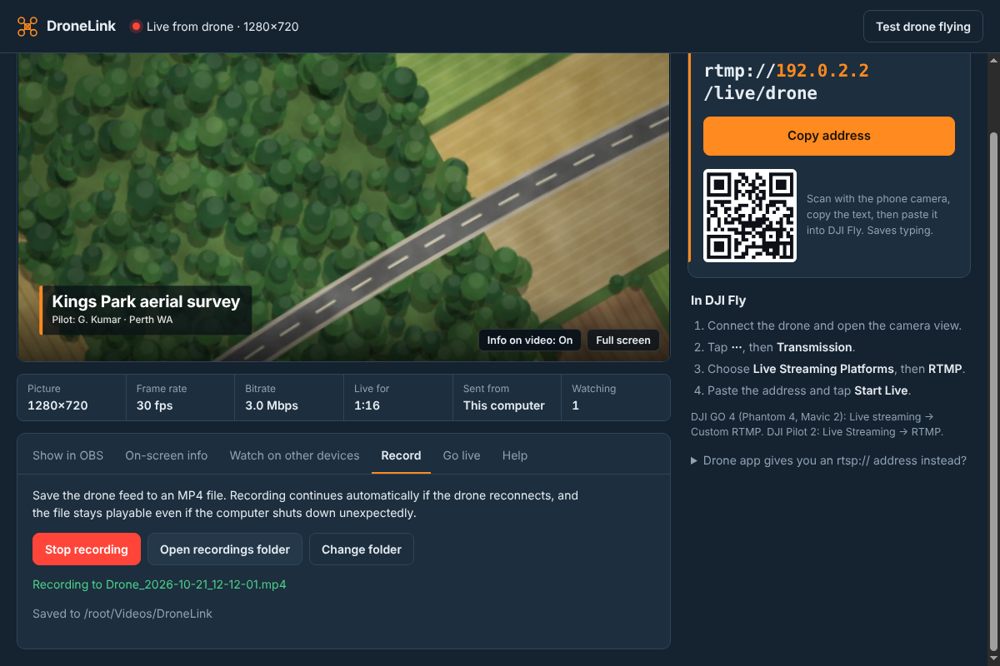

1. Open the **Record** tab and click **Start recording**. You can click it before the drone is live, and recording starts as soon as the picture arrives.
2. A red **REC** badge with a timer appears on the preview, and the note shows the file name, for example `Drone_2026-10-21_10-54-31.mp4`.
3. Click **Stop recording**. "Recording saved" confirms the file is finished.
4. Click **Open recordings folder** to see your files.

| Detail | Value |
| --- | --- |
| Default folder | Windows: `Videos\DroneLink`. Mac: `Movies/DroneLink` |
| Change folder | **Change folder**, then pick any folder or USB drive. It is remembered. |
| If the drone drops out | A new file starts when the feed returns, so one flight can produce several files |
| If the computer crashes | The file up to that moment stays playable |

This is a recording of the live view (usually 720p). For full-quality footage, use the file on the drone's SD card.

## 10. Go live to YouTube, Facebook or another platform

**Go live** sends the drone feed straight to a platform, so you don't need OBS for a simple drone-only stream. If you want the on-screen info, other cameras or commentary, stream from OBS instead and skip this tab.

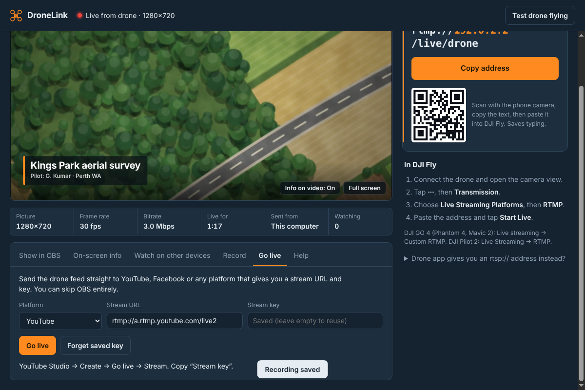

**Get your stream key**

- **YouTube:** YouTube Studio → **Create** → **Go live** → **Stream**. Copy the **Stream key**. A new channel needs live streaming enabled, which can take up to 24 hours the first time.
- **Facebook:** **Live video** → **Streaming software**. Copy the **Stream key**.
- **Other platforms:** copy the RTMP or RTMPS **server URL** and **stream key** from the platform's streaming settings.

**Start**

1. Open the **Go live** tab and choose the **Platform**. YouTube and Facebook fill in the Stream URL for you.
2. Paste the **Stream key** and click **Go live**.
3. The note turns green: "Live on YouTube". Check your platform's dashboard, which usually shows the stream 10 to 20 seconds later.
4. Click **End live stream** when finished, then end the broadcast on the platform as well.

The key is stored encrypted on this computer, so next time leave the box empty and click **Go live**. Click **Forget saved key** to remove it.

This needs internet on the computer. The drone feed is about 3 Mbps, so allow at least 5 Mbps of upload. If the drone drops out, the stream to the platform pauses and resumes by itself. Check your platform's own setting for how long it keeps a broadcast open after the feed stops.

## 11. What you receive, and what happens far away

DroneLink receives the same live view the phone or controller shows. It can never be better than what the controller receives.

| Question | Answer |
| --- | --- |
| Picture quality | The drone app's live stream, usually 720p (some models offer 1080p), about 1 to 3 seconds behind the controller. Full-quality 4K footage stays on the drone's SD card. |
| Sound | None from the drone. DJI's stream carries silent audio. Add your own microphone in OBS. |
| Flight data (altitude, GPS, battery) | Not included in DJI's live stream. The test drone draws its display into the picture for testing only. |
| How far can the drone fly? | As far as its controller can reach it. The drone-to-controller radio sets the range, and DroneLink adds nothing to that limit. |
| Drone far away, weak signal | The controller's picture turns blocky or freezes, and DroneLink shows exactly the same. |
| Signal lost completely | Status shows "Drone feed paused". OBS, viewers, recording and Go live stay connected for 30 seconds and continue by themselves when DJI Fly reconnects. After 30 seconds DroneLink goes back to waiting, and everything still resumes when the drone returns. |
| Phone and computer distance | The phone must stay on the computer's Wi-Fi. Keep the laptop near the pilot, or use the pilot's phone hotspot for the laptop. |

Rehearse the far-away cases with the test drone's **Simulate weak signal** and **Simulate signal loss** buttons (section 5).

## 12. Troubleshooting

Start with the test drone. If its picture appears, DroneLink and OBS are fine, and the problem is between the drone app and the computer.

The **Help** tab in DroneLink lists the supported drones and the most common fixes, so they are at hand during a flight.

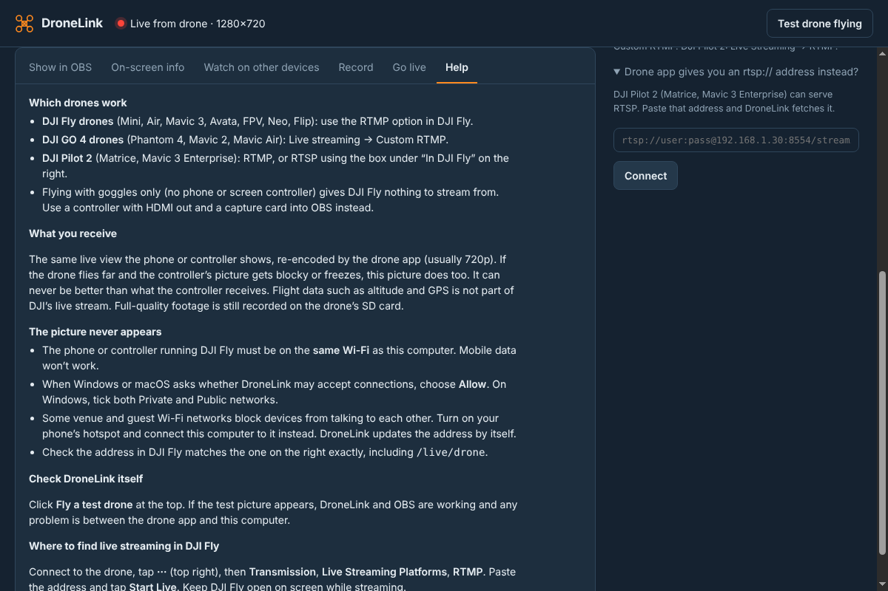

| What you see | Likely cause | Fix |
| --- | --- | --- |
| DJI Fly says it cannot connect, or keeps "Connecting" | Phone and computer on different networks, or the phone is on mobile data | Join both to the same Wi-Fi. On the phone, turn mobile data off while testing. |
| Same networks, still no picture | Firewall blocking DroneLink | Windows: allow DroneLink for Private and Public networks (section 2). Mac: allow incoming connections and Local Network access. |
| Works at home, not at a venue or hotel | Guest Wi-Fi stops devices talking to each other | Turn on the pilot's phone hotspot and join the laptop to it. DroneLink updates the address by itself. |
| Address in DroneLink starts with 169.254 or shows no network | Computer is not really on a network | Reconnect the computer's Wi-Fi, then copy the new address. |
| Several networks listed | Laptop has Wi-Fi plus Ethernet, VPN or a virtual adapter | In **Network**, pick the Wi-Fi the phone is on, then copy the address again. |
| Typed address rejected in DJI Fly | Typing mistake | Use the QR code, or check it ends in `/live/drone` and has no spaces. |
| Picture stops when the pilot checks messages | DJI Fly left the screen | Keep DJI Fly open on screen during the whole flight. |
| Red status: "could not start on port" | Another streaming server uses both the RTMP and preview ports | Close other streaming software (another DroneLink, a local RTMP server) and restart DroneLink. |
| OBS Browser source is black | Address typed wrong, or the drone is not live | Copy the address from the **Show in OBS** tab, and check DroneLink shows a picture. |
| On-screen info missing in OBS | Info turned off, `&clean=1` in the address, or a Media Source is used | Turn on **Info on video**, and use the Browser source address without `&clean=1`. |
| Phone viewer says "This browser can't play the live view" | Old iPhone Safari | Update to iOS 17.1 or later, or use Chrome on Android or a laptop. |
| Go live: "The platform rejected the stream key" | Wrong or expired key | Copy a fresh key from the platform and paste it again. |
| Go live: "Could not reach the platform" | No internet on the computer | Check the internet connection. A phone hotspot with mobile data works for both jobs. |
| Recording: "Cannot write the recording file" | Disk full or folder not allowed | Free some space, or click **Change folder**. |
| Windows says "Windows protected your PC" | App is not code-signed yet | Click **More info**, then **Run anyway**. |

## 13. Pre-flight checklist and quick reference

**Before every live flight**

- [ ] Laptop charged or plugged in. DroneLink keeps it from sleeping while a drone is live.
- [ ] Laptop and pilot's phone on the same Wi-Fi, or laptop on the phone's hotspot
- [ ] DroneLink open and showing "Ready. Waiting for the drone"
- [ ] Test drone flown once, and the picture seen in OBS and on one phone
- [ ] Signal loss simulated once, and OBS recovered by itself
- [ ] On-screen info set (title, clock) or turned off for a clean picture
- [ ] Drone address copied into the drone app
- [ ] Recording started, if you want a copy
- [ ] Go live key pasted and the platform broadcast set up, if streaming online
- [ ] Flight is legal where you are. In Australia, follow CASA rules: line of sight, and no flying over people. Commercial work needs a RePL and ReOC.

**Addresses and ports**

| Item | Value |
| --- | --- |
| Drone address | `rtmp://<computer IP>/live/drone` (shown in the app) |
| OBS Browser source | `http://127.0.0.1:8000/?obs=1` (add `&clean=1` for no on-screen info) |
| OBS Media Source, same computer | `rtmp://127.0.0.1/live/drone` |
| Viewers on the Wi-Fi | `http://<computer IP>:8000/` |
| Ports | 1935 for drones (1936 and up if busy), 8000 for preview and viewers (8001 and up if busy) |
| Recordings | Windows `Videos\DroneLink`, Mac `Movies/DroneLink` |
| Settings | Windows `%APPDATA%\DroneLink`, Mac `~/Library/Application Support/DroneLink` |

If a port moves because the usual one is busy, the addresses in the app change to match. Always copy them from the app.
